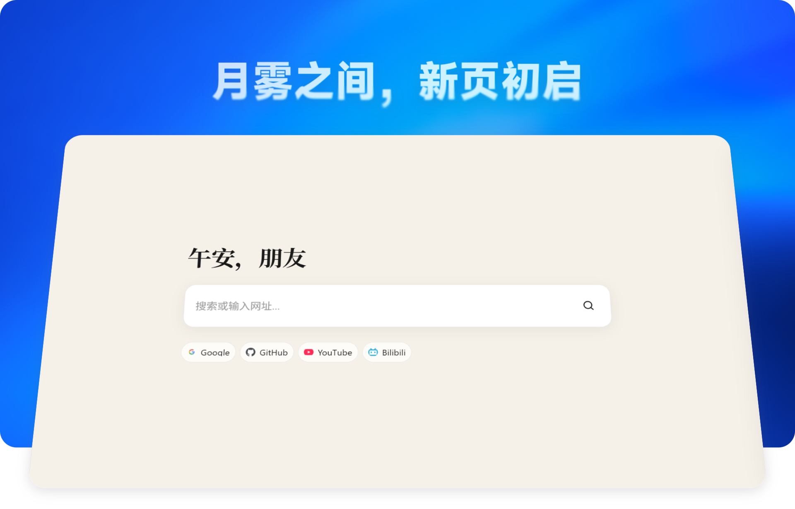

<h1 align="center"> MoonFog 朔雾</h1>

<p align="center">
  <a href="https://microsoftedge.microsoft.com/addons/detail/amgodilcleohpndamnepjhgfjmpohkle"></a>
  &nbsp;&nbsp;
  <a href="https://chromewebstore.google.com/detail/jnheegmemghhmbanifecnkifakjeecen"></a>
</p>



月雾之间，新页初启。MoonFog 是一款把浏览器默认新标签页替换成安静、可定制起始页的开源项目：

- **扩展版**：Manifest V3，Chrome / Edge 开箱即用，兼容 Firefox（AMO 分发），Safari 可经官方转换工具打包
- **网页版**：同一份页面的纯静态站点（`npm run build:web` → `dist-web/`），任何浏览器把网址设为主页 / 新标签页即可使用，可部署到 GitHub Pages

## 网页版（全浏览器通用）

```bash
node scripts/build-web.mjs   # 或 npm run build:web
cd dist-web && npx serve .   # 本地预览
```

推送到 `main` 分支会自动经 `.github/workflows/pages.yml` 部署到 GitHub Pages。

各浏览器把网页版变成「新标签页 / 主页」的方法：

| 浏览器 | 设置路径 |
| --- | --- |
| Chrome | 设置 → 外观 → 显示「主页」按钮（可填网址）；新标签页由扩展接管，建议直接使用扩展版 |
| Edge | 设置 → 开始、主页和新建标签页；同上，新标签页建议使用扩展版 |
| Firefox | 设置 → 主页 → 新窗口和新标签页 → 自定义网址（原生支持网页版直达） |
| Safari | 设置 → 通用 → 「新窗口打开方式 / 新标签页打开方式」选「主页」，主页填网页版地址 |

已知限制：

- **必应每日一图（网页版）**：必应官方接口不带跨域头，网页版按以下顺序获取——① `web-config.js` 配置 `corsProxy`（自建转发，零第三方依赖，优先）；② 未配置时回退公共镜像 `api.codelife.cc`（当日，图源仍为必应官方 CDN，支持取色/离线缓存）与 `peapix.com`（近 7 日，仅显示）。全部不可达时才降级提示。
- **快捷方式图标取色缓存（网页版）**：Google favicon 服务不带跨域头，图标经 `MoonFogEnv.applyCorsProxy` 统一处理——配置 `corsProxy` 后缓存/圆角检测完整可用，未配置时静默跳过；图标本身用 `` 显示，不受影响。
- 一言（hitokoto）、搜索联想（search-sug.lonely.land）已验证支持跨域，网页版功能完整。

## 扩展版支持矩阵

| 浏览器 | 分发方式 | 说明 |
| --- | --- | --- |
| Chrome | `npm run pack` 产出 CRX / zip，Chrome Web Store | 原生支持 |
| Edge | 同上 zip，经 `scripts/publish-edge.mjs` 发布到 Edge Add-ons | 原生支持 |
| Firefox | `npm run pack:firefox` 产出 AMO zip | MV3；`host_permissions` 由用户按需授权（首次使用必应壁纸时允许站点访问）；不含 `fontSettings`（Firefox 无此 API，字体列表自动回退内置清单） |
| Safari | `xcrun safari-web-extension-converter` 转换 Xcode 工程后打包 | Safari 不支持替换新标签页，建议 Safari 用户使用网页版 |

## 功能

- **背景**
  - 本地壁纸（自选图片，动态取色自动配色）
  - 必应每日一图（自动缓存，离线可用）
  - 流光模式（Paper Shaders 渐变动画，可调颜色/噪点/偏移）
  - 纯色背景
- **动态主题**：基于 Material Color Utilities（MCU）从壁纸提取种子色，生成整套明暗配色；支持手动浅色/深色
- **问候语**：按时段（早/午/晚）、用户名自定义文案，字号/粗细/字体可调
- **搜索**：搜索框可搜索或直接打开网址，支持自定义搜索引擎；Google / Bing / 百度输入时显示搜索建议（[search-suggestions](https://github.com/lonely-4/search-suggestions)）
- **快捷导航**：自定义站点图标，支持导入浏览器书签（Netscape HTML）
- **字体**：内置思源宋体，也可选系统字体；正文/问候语可分别设置
- **性能档**：完全 / 部分 / 限制三档，统一控制背景与表面模糊
- **数据**：设置导入/导出，一键重置


## 权限说明

| 权限 | 用途 |
| --- | --- |
| `fontSettings` | 读取系统字体设置（仅 Chromium 内核；Firefox 打包版不含该权限，字体列表自动回退内置清单） |
| `www.bing.com` / `cn.bing.com` | 获取每日一图与图片署名 |
| `hitokoto.cn` / `hitokoto.c0ffee.space` | 一言问候文案 |
| `www.google.com` / `icons.duckduckgo.com` | 站点图标抓取（搜索本身是页面跳转，不使用主机权限） |
| `search-sug.lonely.land` | Google / Bing / 百度的输入建议。只在搜索框有内容且建议开关打开时请求，查询词不落本地 |

不申请 `<all_urls>`。快捷导航站点自身的 favicon，以及关于页作者头像（`static.apanzinc.top`、`q.qlogo.cn`），只作为图片地址加载。

所有偏好仅存储在本地 `localStorage`，不上传、无遥测、无账号。

## 目录结构

```
newtab.html          入口页面（设置面板与主页同页）
manifest.json        MV3 清单
css/                 样式（含 settings/ 子目录）
js/
  env.js             运行环境检测（Chrome / Edge / Firefox / Safari 扩展 vs 网页版）
  background.js      壁纸/流光渲染、必应图与一言缓存（页面脚本）
  theme-manager.js   主题引擎（含图片模式色板）
  theme.js / color-utils.js / material-color-utilities.js
  settings.js / search.js / shortcuts.js / greeting.js ...
  boot-*.js          首屏无闪启动链（在 body 解析时同步执行）
  vendor/            第三方库（MCU、Paper Shaders）
icons/               扩展图标与内置搜索引擎图标
fonts/               内置思源宋体
assets/              README 配图（banner、logo）
scripts/             构建与发布工具（check / pack-extension / build-web / publish-edge）
dist-web/            网页版构建产物（构建生成，不入库）
```

## 许可

Copyright (c) 2026 apanzinc。本项目基于 GNU Affero General Public License v3.0 获得许可。

内置字体：

- 思源宋体（Source Han Serif）版权归 Adobe 所有，基于 [SIL Open Font License 1.1](https://scripts.sil.org/OFL) 获得许可。
- MingCute 图标字体版权归 MingCute 所有，基于 [Apache License 2.0](https://www.apache.org/licenses/LICENSE-2.0) 获得许可。
