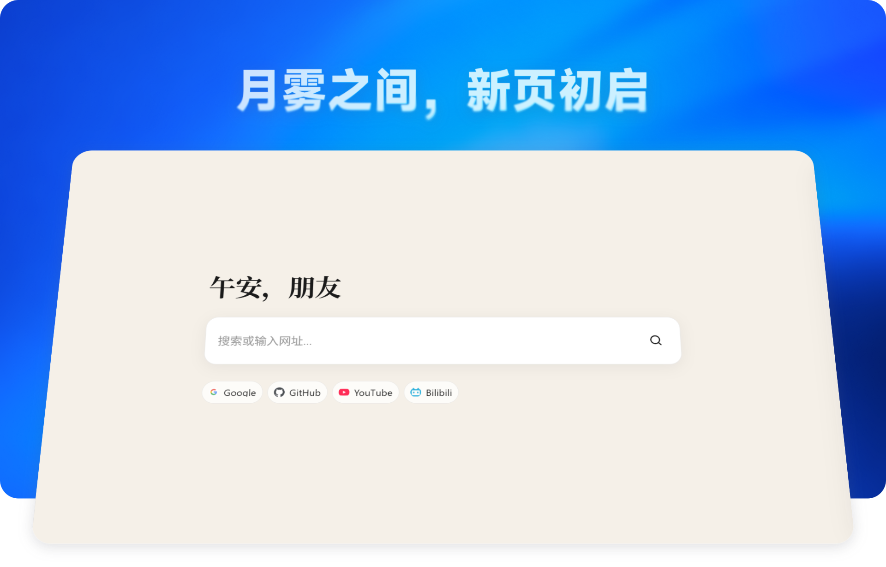

<p align="center">
  
</p>

<h1 align="center">MoonFog 朔雾</h1>

<p align="center"><sub>月雾之间，新页初启</sub></p>

<p align="center">
  <a href="https://microsoftedge.microsoft.com/addons/detail/amgodilcleohpndamnepjhgfjmpohkle"></a>
  &nbsp;&nbsp;
  <a href="https://chromewebstore.google.com/detail/jnheegmemghhmbanifecnkifakjeecen"></a>
</p>



MoonFog 把浏览器默认新标签页换成安静、可定制的起始页。同一份页面同时提供扩展版与网页版，偏好只存在本地，无账号、无遥测。

| 形态 | 说明 |
| --- | --- |
| **扩展版** | Manifest V3，Chrome / Edge 开箱即用，兼容 Firefox（AMO 分发），Safari 可经官方转换工具打包 |
| **网页版** | 纯静态站点（`npm run build:web` → `dist-web/`），任何浏览器把网址设为主页 / 新标签页即可用，可部署到 GitHub Pages |

## 目录

- [快速开始](#快速开始)
- [功能](#功能)
- [浏览器支持](#浏览器支持)
- [权限说明](#权限说明)
- [项目结构](#项目结构)
- [开发](#开发)
- [许可](#许可)

## 快速开始

### 扩展版

从 [Chrome 应用商店](https://chromewebstore.google.com/detail/jnheegmemghhmbanifecnkifakjeecen) 或 [Edge 加载项](https://microsoftedge.microsoft.com/addons/detail/amgodilcleohpndamnepjhgfjmpohkle) 安装即可。本地开发可直接加载仓库根目录（`manifest.json` 所在处），无需构建。

### 网页版

```bash
npm run build:web          # 产物写入 dist-web/
cd dist-web && npx serve . # 本地预览
```

推送到 `main` 会触发 `.github/workflows/ci.yml` 的自检与打包；部署到 GitHub Pages 时把发布目录指向 `dist-web/` 即可。

各浏览器把网页版变成「新标签页 / 主页」的设置路径：

| 浏览器 | 设置路径 |
| --- | --- |
| Chrome | 设置 → 外观 → 显示「主页」按钮（可填网址）；新标签页由扩展接管，建议直接用扩展版 |
| Edge | 设置 → 开始、主页和新建标签页；同上，新标签页建议用扩展版 |
| Firefox | 设置 → 主页 → 新窗口和新标签页 → 自定义网址（原生支持网页版直达） |
| Safari | 设置 → 通用 → 「新窗口打开方式 / 新标签页打开方式」选「主页」，主页填网页版地址 |

**已知限制**

- **必应每日一图**：必应官方接口不带跨域头。网页版按序获取——① `web-config.js` 配置 `corsProxy`（自建转发，零第三方依赖，优先）；② 未配置时回退公共镜像 `api.codelife.cc`（当日，图源仍为必应官方 CDN，支持取色 / 离线缓存）与 `peapix.com`（近 7 日，仅显示）。全部不可达时才降级提示。
- **快捷方式图标取色缓存**：Google favicon 服务不带跨域头，图标经 `MoonFogEnv.applyCorsProxy` 统一处理——配置 `corsProxy` 后缓存与圆角检测完整可用，未配置时静默跳过；图标本身用 `` 显示，不受影响。
- **一言与搜索联想**：均已在两种形态验证可用。扩展版联想直连引擎官方接口，网页版经 `search-sug.lonely.land` 聚合；扩展版搜索通过 `chrome.search` 交给浏览器默认搜索引擎，联想默认开启、可在设置中关闭。

## 功能

| 模块 | 能力 |
| --- | --- |
| 背景 | 纯色 / 流光 / 媒体三选一，详见[背景来源](#背景来源) |
| 动态主题 | 基于 Material Color Utilities（MCU）从壁纸提取种子色，生成整套明暗配色；支持手动浅色 / 深色 |
| 问候语 | 按时段（早 / 午 / 晚）切换、用户名自定义文案，字号 / 粗细 / 字体可调 |
| 搜索 | 搜索框可直接搜索或打开网址，详见[搜索](#搜索) |
| 快捷导航 | 自定义站点图标，支持导入浏览器书签（Netscape HTML） |
| 字体 | 内置思源宋体，也可选系统字体；正文与问候语可分别设置 |
| 性能档 | 完全 / 部分 / 限制三档，统一控制背景与表面模糊 |
| 数据 | 设置导入 / 导出，一键重置 |

### 背景来源

- **纯色**：单一色值，随主题明暗自动调整。
- **流光**：Paper Shaders 渐变动画，可调颜色、噪点与偏移。
- **媒体**：统一入口，来源可选——本地壁纸（自选图片，动态取色自动配色）；必应每日一图（自动缓存，离线可用）。后续可扩展视频等格式。

### 搜索

| 模式 | 行为 |
| --- | --- |
| 跟随浏览器（默认） | 通过 `chrome.search` API 使用浏览器设置中的默认搜索引擎，不读取、不修改用户的搜索设置 |
| 指定引擎 | 在「设置 → 搜索 → 搜索引擎」卡片列表中显式选择 Google / Bing / 百度 / 秘塔 AI 搜索 / ChatGPT / Claude，选中后搜索直接在该引擎中进行 |
| 输入联想 | 输入时显示建议，查询词发送至对应引擎官方联想接口（扩展版直连，网页版经 `search-sug.lonely.land` 聚合），不保存到本地，可关闭 |

联想来源跟随所选引擎，「跟随浏览器」时 Chrome 推断为 Google、Edge 推断为 Bing；所选引擎无联想时按 Google → 必应 → 百度 固定顺序回退（切换引擎后解析一次并缓存），并记住可用来源不重复重试。网页版可选上述引擎或自定义搜索引擎，Google / Bing / 百度 的建议来自 [search-suggestions](https://github.com/lonely-4/search-suggestions)。

## 浏览器支持

| 浏览器 | 分发方式 | 说明 |
| --- | --- | --- |
| Chrome | `npm run pack` 产出 CRX / zip，Chrome Web Store | 原生支持 |
| Edge | 同上 zip，经 `scripts/publish-edge.mjs` 发布到 Edge 加载项 | 原生支持 |
| Edge 安卓 | `npm run pack:edge-mobile` 产出专用 CRX / zip | 不声明桌面专用 `fontSettings` 权限，字体列表自动降级；支持 `EdgA` 宿主识别与回调式搜索 / 权限 API。也可从扩展菜单点击图标打开主页 |
| Firefox | `npm run pack:firefox` 产出 AMO zip | MV3；`host_permissions` 由用户按需授权（首次使用必应壁纸 / 输入联想时允许站点访问）；不含 `fontSettings`（Firefox 无此 API，字体列表自动回退内置清单）与 `search`（无 `chrome.search`，搜索回退到页面内引擎选择） |
| Safari | `xcrun safari-web-extension-converter` 转换 Xcode 工程后打包 | Safari 不支持替换新标签页，建议 Safari 用户使用网页版 |

## 权限说明

| 权限 | 用途 |
| --- | --- |
| `fontSettings` | 读取系统字体设置（仅 Chromium 内核；Firefox 打包版不含该权限，字体列表自动回退内置清单） |
| `search` | 扩展内搜索框通过 `chrome.search` 使用浏览器默认搜索引擎（「跟随浏览器」模式；Firefox 打包版不含该权限，回退页面内引擎选择） |
| `www.bing.com` / `cn.bing.com` | 获取每日一图与图片署名 |
| `hitokoto.cn` / `hitokoto.c0ffee.space` | 一言问候文案 |
| `icons.duckduckgo.com` | 快捷方式站点图标缓存（`www.google.com` 图标由站点自身 favicon 提供，不申请该域名主机权限） |

可选权限，默认不申请，用户打开「输入联想」开关时才弹出一次授权：

| 权限 | 用途 |
| --- | --- |
| `api.bing.com`、`suggestqueries.google.com`、`suggestion.baidu.com` | 扩展版输入联想（可关闭）：输入过程中的查询词直接发送至对应引擎官方联想接口，不保存 |
| `search-sug.lonely.land` | 仅网页版输入联想使用（不涉及扩展安装权限）：受 CORS 限制经聚合接口获取建议，不保存 |

不申请 `<all_urls>`。联想接口只用于输入建议，默认开启、可关闭，不读取网页内容。快捷导航站点自身的 favicon 与关于页作者头像（`static.apanzinc.top`、`q.qlogo.cn`）只作为图片地址加载。所有偏好仅存储在本地 `localStorage`，不上传、无遥测、无账号。

## 项目结构

```text
newtab.html          入口页面（设置面板与主页同页）
manifest.json        MV3 清单
css/                 样式（含 settings/ 子目录）
js/
  env.js             运行环境检测（Chrome / Edge / Firefox / Safari 扩展 vs 网页版）
  background.js      壁纸 / 流光渲染、必应图与一言缓存（页面脚本）
  theme-manager.js   主题引擎（含图片模式色板）
  theme.js / color-utils.js / material-color-utilities.js
  settings.js / search.js / shortcuts.js / greeting.js ...
  boot-*.js          首屏无闪启动链（在 body 解析时同步执行）
  vendor/            第三方库（MCU、Paper Shaders）
icons/               扩展图标与内置搜索引擎图标
fonts/               内置思源宋体
assets/              README 配图（banner、logo、商店徽章）
scripts/             构建与发布工具（check / pack-extension / build-web / publish-edge）
dist-web/            网页版构建产物（构建生成，不入库）
```

## 开发

```bash
npm install
npm run serve      # 开发服务器 http://localhost:8132
npm run check      # 静态自检（HTML 引用、清单、图标等）
npm test           # 运行时回归与发布脚本单元测试
npx playwright install chromium
npm run test:e2e   # 桌面 / Edge 安卓 UA、真实扩展协议与独立网页版产物
```

| 脚本 | 作用 |
| --- | --- |
| `npm run check` | 静态自检，校验 HTML 引用、清单与资源完整性 |
| `npm test` | 搜索竞态、URL、宿主与 API 降级，以及发布脚本回归 |
| `npm run test:e2e` | OOBE、媒体切换、空闲帧、触屏、扩展 CSP 与网页版构建回归；自动构建并启动测试服务器 |
| `npm run serve` | 本地开发服务器（端口 8132，支持局域网与虚拟局域网访问） |
| `npm run build:web` | 构建网页版到 `dist-web/` |
| `npm run pack` | 打包扩展（Chrome / Edge） |
| `npm run pack:firefox` | 打包 Firefox（AMO）版本 |
| `npm run pack:edge-mobile` | 打包 Edge 安卓版本，去掉桌面字体权限 |
| `npm run fonts` | 重新生成字体 unicode-range 分片 |
| `npm run icons` | 重新生成图标字体子集 |

本轮修复与测试边界见 [质量验证记录](docs/quality-validation.md)。

## 许可

Copyright (c) 2026 apanzinc。本项目基于 GNU Affero General Public License v3.0 获得许可。

内置字体与图标：

- 思源宋体（Source Han Serif）版权归 Adobe 所有，基于 [SIL Open Font License 1.1](https://scripts.sil.org/OFL) 获得许可。
- MingCute 图标字体版权归 MingCute 所有，基于 [Apache License 2.0](https://www.apache.org/licenses/LICENSE-2.0) 获得许可。
